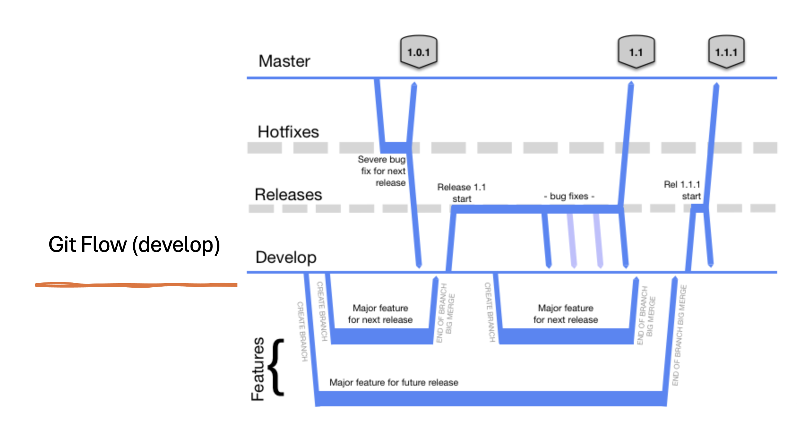

# mmo-ecc-pdf-svc

# Things to Consider
* This repository should use GitFlow as a branching strategy.
* 
* If you won't call your branch as per agreed branching `standards`, the Azure pipeline won't start or may fail to deploy an image.


## Overview

A service that provides pdf related functionality for export catch certificates such as rendering pdfs and storing to 
Azure blob storage.

## Configuration
 - AZURE_STORAGE_CONNECTION_STRING

## Native PDF runtime

Use Node.js 26 and npm 11 or 12 (`npm ci`). PDFKit remains pinned to 0.15.1.
PDF manipulation and parsing use `@muhammara/native` 7.2.3, the prebuilt-only
package. Its Node-API 8 binary supports Node.js 20, 22, 24 and >=25, including
Node.js 26; no Node-26-specific ABI archive is required. The published release
includes macOS ARM64/x64, Linux ARM64/x64 (glibc/musl), Linux RISC-V64 (glibc)
and Windows x64 binaries.

Installation must download a matching prebuilt and `require('@muhammara/native')`
must succeed. Do not bypass installation scripts or substitute
`@muhammara/native-with-source`: local compilation is not part of this migration.
The writable adapter passes Buffer chunks through and reports the full accepted
byte count even when the Node.js stream signals backpressure. Blank renderers
finalize the native writer before ending the destination stream.

Version 2.4.38 contains this migration. Published 2.4.37 still depends on
`muhammara` 6.0.6: consumers must adopt a newly published migrated version and
regenerate their lockfiles. A local `npm pack` can validate a consumer before
release, but does not replace that release step.

## Testing

```shell
 $ npm test -- --runInBand
 $ npm run test:integration
```

Unit tests include real native rendering and page parsing for all three blank
document types, application parsing of all three supported historical form
fixtures, and Buffer/full-chunk stream adapter regressions. Azure
integration tests require configured storage and are not needed for this
dependency-only change.
